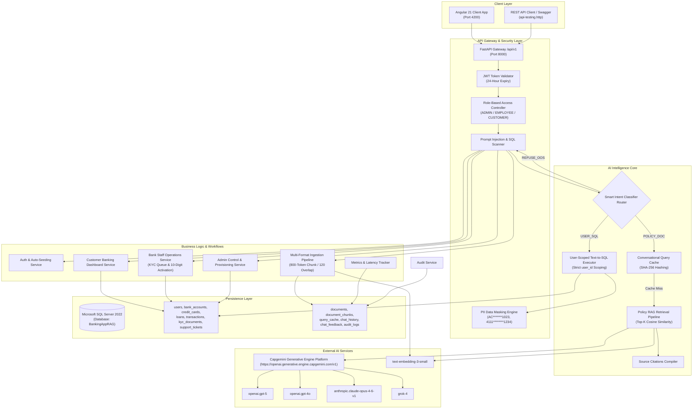
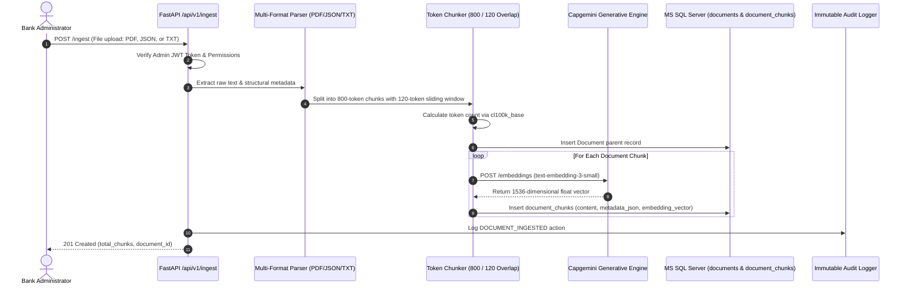
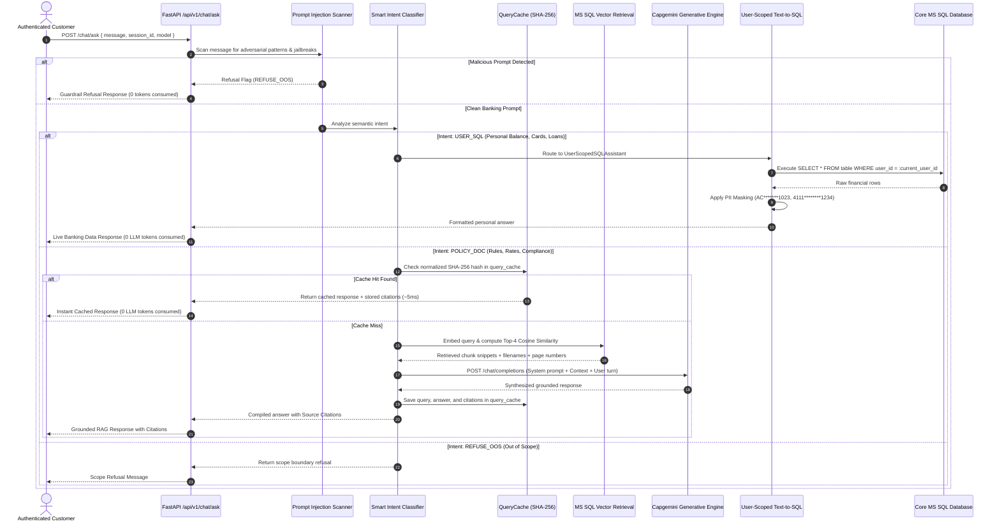
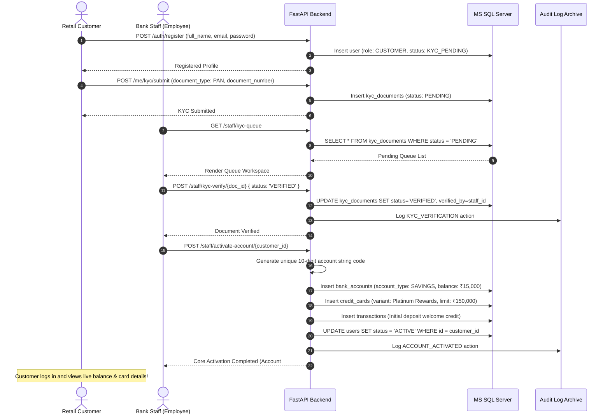

# High-Level Design (HLD) Document
## Capgemini Apex Commercial Bank - Enterprise AI Banking & RAG Platform

---

### Document Information
- **Project Name:** Capgemini Apex Commercial Bank RAG System
- **Version:** 1.0.0
- **Database Engine:** Microsoft SQL Server 2022
- **Backend Framework:** FastAPI (Python 3.12)
- **Frontend Framework:** Angular 21 (Standalone Components & Signals)
- **AI Platform:** Capgemini Generative Engine (`https://openai.generative.engine.capgemini.com/v1`)
- **Document Status:** Approved & Implemented

---

## 1. Executive Summary & Objective

The **Capgemini Apex Commercial Bank AI Banking Platform** is an enterprise-grade, secure, multi-role financial software application. It integrates traditional core banking functionalities (account lifecycle management, credit lines, lending facilities, and transactional logging) with modern Generative AI capabilities (Retrieval-Augmented Generation, User-Scoped Text-to-SQL, Multi-Model LLM Routing, and Conversational Query Caching).

The platform enforces strict Role-Based Access Control (RBAC) across three distinct organizational personas:
1. **Customer (Retail User):** Self-registers in `KYC_PENDING` status, submits identity credentials, queries personal balances/cards/loans/transactions with automated PII masking, and interacts with the AI Assistant for policy guidance and financial data.
2. **Employee (Bank Staff):** Manages the pending KYC verification queue, audits customer identity documentation, executes 10-digit core bank account activations with initial credit provisioning, and resolves customer support tickets. Staff members are strictly barred from administrative actions.
3. **Admin (System Super-User):** Auto-seeded at system startup (`admin@capgemini-bank.com`), provisions bank employee accounts, triggers multi-format document vectorization (PDF, JSON, TXT), monitors system telemetry/latency metrics, and inspects immutable compliance audit logs.

---

## 2. Core Business Problem & Use Case Alignment

```
┌──────────────────────────────────────────────────────────────────────────────────┐
│                             5 CORE SYSTEM USE CASES                              │
├──────────────────────────────────────────────────────────────────────────────────┤
│ 1. Foundation & Core Retrieval: Multi-format chunking (800/120) & MS SQL vectors  │
│ 2. End-to-End RAG Assistant: Policy guidelines with precise source citations     │
│ 3. Secure Banking Data Integration: User-scoped Text-to-SQL with PII masking     │
│ 4. Intelligence Maturity: Query caching (0-token response) & telemetry metrics    │
│ 5. Unified Integration: Smart Intent Classifier Router with strict RBAC          │
└──────────────────────────────────────────────────────────────────────────────────┘
```

### Usecase 1: Foundation & Core Retrieval for Banking Policies
- **Problem:** Official banking rulebooks (loan compliance, interest rate tables, deposit penalties) exist as unstructured manuals across heterogeneous formats (PDF, JSON, TXT). Manual retrieval by staff or keyword search is slow, error-prone, and causes hallucinations in traditional chatbots.
- **Solution:** A background vectorization pipeline that parses PDF (`pypdf`), structured JSON, and TXT files, splits text using 800-token boundaries with 120-token window overlap (`cl100k_base` tokenization), generates vector embeddings via Capgemini Generative Engine (`text-embedding-3-small`), and stores chunks and embeddings in MS SQL Server tables.

### Usecase 2: End-to-End RAG Banking Assistant
- **Problem:** AI chatbots often invent interest rates or financial rules (hallucination) or succumb to prompt injection attacks.
- **Solution:** The RAG assistant retrieves the top matching chunks using cosine similarity from MS SQL, constructs a strict system prompt instructing the model to answer *solely* from provided context, returns exact numbers, and appends a **Source Citations Engine** linking the answer to the exact filename, title, page, and chunk index.

### Usecase 3: Secure Banking Data Integration (User-Scoped Text-to-SQL)
- **Problem:** Customers need immediate natural language answers to personal inquiries (e.g., "What is my account balance?", "What are my credit card limits?"). An LLM cannot guess private database records, and direct SQL generation risks cross-user data leakage and SQL injection.
- **Solution:** A dedicated **User-Scoped SQL Assistant** that detects personal intent, strictly filters all SQL executions by `WHERE user_id = :current_user_id`, validates read-only statements, enforces parameterization, and runs automated PII masking on account numbers (`AC*******1023`) and credit cards (`4111********1234`).

### Usecase 4: Intelligence Maturity & Optimization
- **Problem:** Repetitive querying of large foundation models (GPT-5, Claude) creates latency bottlenecks (5–10 seconds per request) and high operational token expenses.
- **Solution:** An automated **Conversational Query Cache (`query_cache`)** using SHA-256 query normalization. Duplicate policy questions are answered in **~5ms with 0 token consumption**. System telemetry (`/metrics`) tracks latency benchmarks, token usage, and cache hit ratios.

### Usecase 5: Final Integrated Banking RAG System
- **Problem:** Isolated tools for chat, database access, and compliance create fractured user experiences and security holes.
- **Solution:** A centralized **Smart Intent Classifier Router** that parses incoming prompts at the gateway and immediately branches execution into `POLICY_DOC` (RAG), `USER_SQL` (Personal Data), or `REFUSE_OOS` (Security Refusal).

---

## 3. System Architecture



---

## 4. Multi-Role Authorization & RBAC Matrix

The system enforces three explicit roles with strict boundary segregation:

| Capability / API Route | Customer (`CUSTOMER`) | Bank Staff (`EMPLOYEE`) | System Admin (`ADMIN`) |
|---|:---:|:---:|:---:|
| **Public Self-Registration** (`POST /auth/register`) | ✅ Yes (Default: `KYC_PENDING`) | ❌ No public access | 🤖 Auto-seeded on startup |
| **Authentication & JWT Issuance** (`POST /auth/login`) | ✅ Yes (24-hr token) | ✅ Yes (24-hr token) | ✅ Yes (24-hr token) |
| **View Personal Balances** (`GET /me/balance`) | ✅ Yes (Masked) | ❌ Forbidden (403) | ❌ Forbidden (403) |
| **View Credit Cards & Limits** (`GET /me/cards`) | ✅ Yes (Masked) | ❌ Forbidden (403) | ❌ Forbidden (403) |
| **View Active Loans & EMIs** (`GET /me/loans`) | ✅ Yes (Masked) | ❌ Forbidden (403) | ❌ Forbidden (403) |
| **View Transaction Traces** (`GET /me/transactions`) | ✅ Yes | ❌ Forbidden (403) | ❌ Forbidden (403) |
| **Submit KYC Proof** (`POST /me/kyc/submit`) | ✅ Yes (PAN/Aadhaar) | ❌ Forbidden (403) | ❌ Forbidden (403) |
| **Open Support Ticket** (`POST /me/tickets`) | ✅ Yes | ❌ Forbidden (403) | ❌ Forbidden (403) |
| **Pending KYC Queue Workspace** (`GET /staff/kyc-queue`) | ❌ Forbidden (403) | ✅ Yes | ✅ Yes (Supervision) |
| **Audit & Verify KYC Document** (`POST /staff/kyc-verify/{id}`) | ❌ Forbidden (403) | ✅ Yes | ✅ Yes (Supervision) |
| **10-Digit Core Account Activation** (`POST /staff/activate-account/{id}`) | ❌ Forbidden (403) | ✅ Yes | ✅ Yes (Supervision) |
| **Action Support Ticket** (`POST /staff/tickets/{id}/action`) | ❌ Forbidden (403) | ✅ Yes | ✅ Yes (Supervision) |
| **Provision Bank Staff Profile** (`POST /admin/employees`) | ❌ Forbidden (403) | ❌ Forbidden (403) | ✅ Yes |
| **Directory of All Users** (`GET /admin/users`) | ❌ Forbidden (403) | ❌ Forbidden (403) | ✅ Yes |
| **Document Ingestion (PDF/JSON/TXT)** (`POST /ingest`) | ❌ Forbidden (403) | ❌ Forbidden (403) | ✅ Yes |
| **Trigger Knowledge Base Re-Seed** (`POST /ingest/seed`) | ❌ Forbidden (403) | ❌ Forbidden (403) | ✅ Yes |
| **Inspect Immutable Audit Logs** (`GET /admin/audit-logs`) | ❌ Forbidden (403) | ❌ Forbidden (403) | ✅ Yes |
| **Performance Telemetry Metrics** (`GET /metrics`) | ❌ Forbidden (403) | ✅ Yes | ✅ Yes |
| **AI Assistant (RAG Policy Queries)** (`POST /chat/ask`) | ✅ Yes | ✅ Yes | ✅ Yes |
| **AI Assistant (User-Scoped Live Balance)** (`POST /chat/ask`) | ✅ Yes (Personal only) | ❌ (No personal acc) | ❌ (No personal acc) |
| **Multi-Model Override** (`gpt-5`, `gpt-4o`, `claude`, `grok-4`) | ✅ Yes | ✅ Yes | ✅ Yes |

---

## 5. End-to-End Data Flow Architectures

### 5.1 Document Ingestion & Vector Indexing Flow



### 5.2 Customer Query Processing & Smart Intent Routing Flow



### 5.3 KYC Audit & Core Account Activation Flow



---

## 6. Technology Stack & Infrastructure

| Layer | Component | Version / Specification | Rationale |
|---|---|---|---|
| **Language** | Python | 3.12.10 | Modern asynchronous features, type annotations, high performance |
| **Backend Framework** | FastAPI | >= 0.110.0 | High-throughput asynchronous REST API with automatic OpenAPI Swagger docs |
| **ASGI Server** | Uvicorn | >= 0.28.0 | Standard high-performance ASGI server |
| **Database Engine** | Microsoft SQL Server | 2022 Express / Enterprise (X64) | Enterprise relational durability, ACID transactions, relational integrity |
| **Database Driver** | ODBC Driver 18 for SQL Server | pyodbc 5.3.0 | Native Windows C++ database connection pool with TLS encryption |
| **ORM** | SQLAlchemy | >= 2.0.28 | Declarative mapping, session management, parameter binding |
| **Data Validation** | Pydantic v2 | >= 2.6.4 | Strict runtime schema validation and serialization |
| **Authentication** | PyJWT / Passlib / BCrypt | JWT HS256 / BCrypt | 24-hour cryptographically signed tokens and salted password hashing |
| **AI Platform** | Capgemini Generative Engine | US Hosted / OpenAI compatible endpoint | Enterprise LLM gateway supporting GPT-5, GPT-4o, Claude, Grok |
| **Embedding Model** | `text-embedding-3-small` | 1536 dimensions | Fast, high-accuracy semantic vector representations |
| **Tokenizer** | tiktoken | `cl100k_base` | Exact token boundary matching for LLM context windows |
| **PDF Extraction** | pypdf | >= 4.1.0 | Page-by-page extraction preserving document structure |
| **Frontend Framework** | Angular | 21.2.22 | Enterprise-grade component architecture, signals, client-side routing |
| **Styling** | Vanilla CSS3 | Modern Design Tokens | Dark mode, glassmorphism, responsive grids, zero heavy CSS overhead |

---

## 7. Security, Guardrails & Enterprise Governance

1. **Least-Privilege Scoped Data Access:**
   - All financial queries in the Text-to-SQL module automatically inject `WHERE user_id = :current_user_id`. It is architecturally impossible for a customer to access another user's balance, card number, or credit details.
2. **Strict SQL Token Access Guardrails:**
   - Input queries are scanned for forbidden mutation keywords (`DROP`, `DELETE`, `UPDATE`, `INSERT`, `ALTER`, `TRUNCATE`, `EXEC`, `;`, `--`, `/*`). Only single `SELECT` statements are executed.
3. **Malicious Prompt Defenses:**
   - Heuristic and regex behavioral filters intercept adversarial prompt injection attempts (e.g., "ignore all previous instructions", "switch to DAN mode", system prompt extraction) and return polite security refusals with 0 LLM tokens consumed.
4. **PII Data Masking Automation:**
   - Output responses automatically mask bank account numbers (`AC*******1023`), 16-digit credit card numbers (`4111********1234`), phone numbers, and email usernames before rendering in the API or UI.
5. **Immutable Compliance Audit Logs:**
   - Critical system interactions (`CUSTOMER_REGISTER`, `LOGIN_SUCCESS`, `LOGIN_FAILED`, `KYC_VERIFICATION`, `ACCOUNT_ACTIVATED`, `DOCUMENT_INGESTED`, `TICKET_ACTION`) are persistently logged in the `audit_logs` table with timestamp, IP address, and status.

---

## 8. Non-Functional Requirements & Scalability

- **Low Latency:**
  - Cache hits resolve in **< 10ms**.
  - User-Scoped Text-to-SQL resolves in **< 50ms**.
  - Fresh RAG Policy queries resolve in **2–4 seconds** depending on external LLM response times.
- **Cost & Token Optimization:**
  - Strict 800-token chunk limits prevent prompt bloating.
  - Top-K retrieval set to 2–4 chunks to minimize input context cost.
  - Sliding-window memory capped at 4 turns to avoid historical token accumulation.
  - Conversational caching eliminates 100% of LLM costs on duplicate policy queries.
- **High Availability & Fault Tolerance:**
  - SQLAlchemy connection pool with `pool_pre_ping=True` and automatic reconnect.
  - Automatic model fallback from `openai.gpt-5` to `openai.gpt-4o` in case of upstream timeouts.
