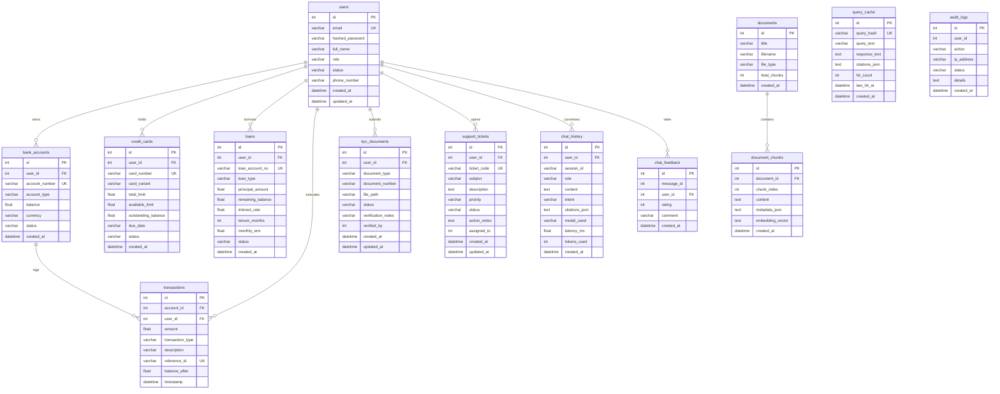

# Low-Level Design (LLD) Document
## Capgemini Apex Commercial Bank - Enterprise AI Banking & RAG Platform

---

### Document Information
- **Project Name:** Capgemini Apex Commercial Bank RAG System
- **Version:** 1.0.0
- **Document Scope:** Class definitions, database schema, algorithms, mathematical models, API contracts, and Angular components.
- **Status:** Implemented & Verified

---

## 1. Directory & Package Structure

```
BankingAppRAG/
├── backend/
│   ├── .env                                # Environment secrets & configuration
│   ├── requirements.txt                    # Python runtime dependencies
│   ├── api-testing.http                    # 28-point REST API Client test suite
│   ├── tests/
│   │   └── test_api_suite.py               # Automated pytest/unittest suite
│   └── app/
│       ├── main.py                         # Application entrypoint & lifespan events
│       ├── core/                           # System core utilities
│       │   ├── config.py                   # Pydantic BaseSettings
│       │   ├── security.py                 # BCrypt & PyJWT cryptographic utilities
│       │   ├── guardrails.py               # Prompt injection & SQL token checks
│       │   └── masking.py                  # PII data masking automation
│       ├── db/
│       │   └── session.py                  # SQLAlchemy engine & session factory
│       ├── models/                         # SQLAlchemy 2.0 ORM entities
│       │   ├── __init__.py                 # Model registry exports
│       │   ├── user.py                     # User entity
│       │   ├── banking.py                  # Accounts, cards, loans, transactions, KYC
│       │   └── rag.py                      # Chunks, cache, history, feedback, audit
│       ├── schemas/                        # Pydantic v2 DTO schemas
│       │   ├── __init__.py                 # Schema registry exports
│       │   ├── auth.py                     # Auth request/response DTOs
│       │   ├── banking.py                  # Banking & staff DTOs
│       │   ├── chat.py                     # AI Chat & citation DTOs
│       │   └── admin.py                    # Ingestion, health & telemetry DTOs
│       ├── services/                       # Business logic services
│       │   ├── __init__.py                 # Service registry exports
│       │   ├── auth_service.py             # Auth & Admin auto-seeding
│       │   ├── staff_service.py            # KYC audit & 10-digit account activation
│       │   ├── customer_service.py         # Customer dashboard operations
│       │   ├── ingest_service.py           # Multi-format document parser & vectorizer
│       │   ├── telemetry_service.py        # System metrics & latency calculator
│       │   └── audit_service.py            # Immutable compliance logging
│       ├── ai/                             # Intelligence & RAG pipeline
│       │   ├── __init__.py                 # AI module exports
│       │   ├── generative_engine.py        # Capgemini Generative Engine HTTP client
│       │   ├── chunking.py                 # 800/120 token boundary parser (JSON/TXT/PDF)
│       │   ├── vector_store.py             # Cosine similarity vector search in SQL
│       │   ├── intent_classifier.py        # Smart Intent Classifier Router
│       │   ├── text_to_sql.py              # User-scoped financial SQL executor
│       │   ├── cache_service.py            # SHA-256 conversational query cache
│       │   └── rag_assistant.py            # RAG orchestration & citations engine
│       ├── api/                            # HTTP presentation layer
│       │   ├── deps.py                     # Dependencies & RBAC route guards
│       │   ├── api.py                      # API v1 router aggregator
│       │   └── routers/                    # Domain controllers
│       │       ├── auth.py                 # /auth/register, /auth/login, /auth/me
│       │       ├── customer.py             # /me/balance, /me/cards, /me/loans, etc.
│       │       ├── staff.py                # /staff/kyc-queue, /staff/activate-account
│       │       ├── admin.py                # /admin/employees, /admin/users, /admin/logs
│       │       ├── chat.py                 # /chat/ask, /chat/models, /chat/feedback
│       │       ├── ingest.py               # /ingest, /ingest/seed
│       │       └── system.py               # /health, /metrics
│       └── data/                           # Ingested knowledge assets
│           ├── banking_interest_rates.json # Fixed deposit and lending rates
│           ├── loan_compliance_rules.txt   # LTV, CIBIL and foreclosure guidelines
│           └── banking_policy.pdf          # Official bank operating manual
└── frontend/                               # Angular 21 Single Page Application
    ├── angular.json
    ├── package.json
    └── src/
        ├── app/
        │   ├── app.ts                      # Root component
        │   ├── app.config.ts               # Application config & HTTP client provider
        │   ├── app.routes.ts               # Route definitions & guards
        │   ├── guards/
        │   │   └── role.guard.ts           # Client-side RBAC guard
        │   ├── services/
        │   │   ├── auth.service.ts         # User session & token state
        │   │   ├── api.service.ts          # REST client for banking endpoints
        │   │   └── chat.service.ts         # Chat client for AI assistant
        │   └── components/
        │       ├── auth/login.component.ts # Login & Customer self-registration
        │       ├── customer/customer.component.ts # Customer banking dashboard
        │       ├── staff/staff.component.ts# KYC queue & account activation
        │       ├── admin/admin.component.ts# Staff provisioning & governance
        │       └── chat/chat.component.ts  # Floating AI assistant widget
        └── styles.css                      # Global design system & theme
```

---

## 2. Database Schema Specifications (MS SQL Server 2022)

### 2.1 Entity Relationship (ER) Diagram



### 2.2 Table Definitions & Data Types

#### Table: `users`
| Column Name | Data Type | Constraints | Default | Description |
|---|---|---|---|---|
| `id` | `INTEGER` | PRIMARY KEY, IDENTITY(1,1), INDEX | - | Internal unique user identifier |
| `email` | `VARCHAR(255)` | UNIQUE, NOT NULL, INDEX | - | User login email address |
| `hashed_password` | `VARCHAR(255)` | NOT NULL | - | Salted BCrypt password hash |
| `full_name` | `VARCHAR(255)` | NOT NULL | - | Full legal name of user |
| `role` | `VARCHAR(50)` | NOT NULL | `'CUSTOMER'` | Role: `ADMIN`, `EMPLOYEE`, `CUSTOMER` |
| `status` | `VARCHAR(50)` | NOT NULL | `'KYC_PENDING'` | Status: `KYC_PENDING`, `ACTIVE`, `SUSPENDED` |
| `phone_number` | `VARCHAR(50)` | NULL | `NULL` | Optional contact telephone number |
| `created_at` | `DATETIME` | NOT NULL | `UTC_TIMESTAMP` | Account creation timestamp |
| `updated_at` | `DATETIME` | NOT NULL | `UTC_TIMESTAMP` | Last profile update timestamp |

#### Table: `bank_accounts`
| Column Name | Data Type | Constraints | Default | Description |
|---|---|---|---|---|
| `id` | `INTEGER` | PRIMARY KEY, IDENTITY(1,1) | - | Internal account identifier |
| `user_id` | `INTEGER` | FOREIGN KEY (`users.id`), NOT NULL, INDEX | - | Customer owner foreign key |
| `account_number` | `VARCHAR(20)` | UNIQUE, NOT NULL, INDEX | - | Unique 10-digit account string code |
| `account_type` | `VARCHAR(50)` | NOT NULL | `'SAVINGS'` | `SAVINGS`, `CURRENT`, `SALARY` |
| `balance` | `FLOAT` | NOT NULL | `0.0` | Real-time cleared balance |
| `currency` | `VARCHAR(10)` | NOT NULL | `'INR'` | Currency denomination |
| `status` | `VARCHAR(50)` | NOT NULL | `'ACTIVE'` | Account status (`ACTIVE`, `FROZEN`) |
| `created_at` | `DATETIME` | NOT NULL | `UTC_TIMESTAMP` | Opening date timestamp |

#### Table: `credit_cards`
| Column Name | Data Type | Constraints | Default | Description |
|---|---|---|---|---|
| `id` | `INTEGER` | PRIMARY KEY, IDENTITY(1,1) | - | Internal card record ID |
| `user_id` | `INTEGER` | FOREIGN KEY (`users.id`), NOT NULL | - | Cardholder user ID |
| `card_number` | `VARCHAR(30)` | UNIQUE, NOT NULL, INDEX | - | 16-digit card number |
| `card_variant` | `VARCHAR(50)` | NOT NULL | `'Platinum Rewards'` | Card tier / product name |
| `total_limit` | `FLOAT` | NOT NULL | `100000.0` | Total approved credit line |
| `available_limit`| `FLOAT` | NOT NULL | `100000.0` | Available revolving credit line |
| `outstanding_balance` | `FLOAT` | NOT NULL | `0.0` | Billed + unbilled spend |
| `due_date` | `VARCHAR(50)` | NULL | `NULL` | Next payment due date (YYYY-MM-DD) |
| `status` | `VARCHAR(50)` | NOT NULL | `'ACTIVE'` | Status (`ACTIVE`, `BLOCKED`) |
| `created_at` | `DATETIME` | NOT NULL | `UTC_TIMESTAMP` | Issuance timestamp |

#### Table: `loans`
| Column Name | Data Type | Constraints | Default | Description |
|---|---|---|---|---|
| `id` | `INTEGER` | PRIMARY KEY, IDENTITY(1,1) | - | Internal loan facility ID |
| `user_id` | `INTEGER` | FOREIGN KEY (`users.id`), NOT NULL | - | Borrower user ID |
| `loan_account_no`| `VARCHAR(30)` | UNIQUE, NOT NULL, INDEX | - | Loan contract identifier |
| `loan_type` | `VARCHAR(50)` | NOT NULL | - | `Home Loan`, `Personal Loan`, `Auto Loan` |
| `principal_amount`| `FLOAT` | NOT NULL | - | Sanctioned borrowing value |
| `remaining_balance`| `FLOAT` | NOT NULL | - | Outstanding principal balance |
| `interest_rate` | `FLOAT` | NOT NULL | - | Annual percentage interest rate |
| `tenure_months` | `INTEGER` | NOT NULL | - | Total loan duration in months |
| `monthly_emi` | `FLOAT` | NOT NULL | - | Equated Monthly Installment |
| `status` | `VARCHAR(50)` | NOT NULL | `'ACTIVE'` | Status (`ACTIVE`, `CLOSED`, `DEFAULTED`)|
| `created_at` | `DATETIME` | NOT NULL | `UTC_TIMESTAMP` | Disbursement timestamp |

#### Table: `transactions`
| Column Name | Data Type | Constraints | Default | Description |
|---|---|---|---|---|
| `id` | `INTEGER` | PRIMARY KEY, IDENTITY(1,1) | - | Internal transaction ledger ID |
| `account_id` | `INTEGER` | FOREIGN KEY (`bank_accounts.id`), NOT NULL | - | Linked bank account ID |
| `user_id` | `INTEGER` | FOREIGN KEY (`users.id`), NOT NULL | - | User party identifier |
| `amount` | `FLOAT` | NOT NULL | - | Absolute transaction amount |
| `transaction_type`| `VARCHAR(20)` | NOT NULL | - | `'CREDIT'` or `'DEBIT'` |
| `description` | `VARCHAR(255)` | NOT NULL | - | Ledger narrative / remarks |
| `reference_id` | `VARCHAR(50)` | UNIQUE, NOT NULL, INDEX | - | Unique tracking reference code |
| `balance_after` | `FLOAT` | NOT NULL | - | Account balance immediately post-event |
| `timestamp` | `DATETIME` | NOT NULL | `UTC_TIMESTAMP` | Transaction execution timestamp |

#### Table: `kyc_documents`
| Column Name | Data Type | Constraints | Default | Description |
|---|---|---|---|---|
| `id` | `INTEGER` | PRIMARY KEY, IDENTITY(1,1) | - | Internal KYC record ID |
| `user_id` | `INTEGER` | FOREIGN KEY (`users.id`), NOT NULL | - | Submitting customer user ID |
| `document_type` | `VARCHAR(50)` | NOT NULL | - | `PAN`, `AADHAAR`, `PASSPORT` |
| `document_number`| `VARCHAR(100)`| NOT NULL | - | Government identity code |
| `file_path` | `VARCHAR(500)`| NULL | `NULL` | Uploaded document asset file path |
| `status` | `VARCHAR(50)` | NOT NULL | `'PENDING'` | `PENDING`, `VERIFIED`, `REJECTED` |
| `verification_notes`| `VARCHAR(500)`| NULL | `NULL` | Staff verification comments |
| `verified_by` | `INTEGER` | NULL | `NULL` | Employee user ID who reviewed |
| `created_at` | `DATETIME` | NOT NULL | `UTC_TIMESTAMP` | Upload timestamp |
| `updated_at` | `DATETIME` | NOT NULL | `UTC_TIMESTAMP` | Last status update timestamp |

#### Table: `documents` & `document_chunks`
- `documents`: Stores high-level document metadata (`id`, `title`, `filename`, `file_type`, `total_chunks`, `created_at`).
- `document_chunks`: Stores atomic retrieval fragments:
  - `document_id`: Foreign key referencing parent `documents.id`.
  - `chunk_index`: Integer order index within document (0, 1, 2, ...).
  - `content`: Extracted plain text (up to 800 tokens).
  - `metadata_json`: Serialized JSON storing page numbers, document titles, and source paths.
  - `embedding_vector`: Serialized 1536-dimensional float vector produced by `text-embedding-3-small`.

#### Table: `query_cache`
- `query_hash`: `VARCHAR(64)` unique SHA-256 hash of normalized user query.
- `query_text`: Normalized query string.
- `response_text`: Cached RAG generated response.
- `citations_json`: Serialized JSON citations array.
- `hit_count`: Integer counter incremented on every cache hit.
- `last_hit_at`: Timestamp of most recent cache retrieval.

#### Table: `audit_logs`
- `id`: Auto-incrementing primary key.
- `user_id`: Optional ID of acting user.
- `action`: String code (`LOGIN_SUCCESS`, `ACCOUNT_ACTIVATED`, `DOCUMENT_INGESTED`, etc.).
- `ip_address`: Remote client IP address.
- `status`: `SUCCESS`, `FAILED`, `BLOCKED`.
- `details`: Text narrative explaining the action context.
- `created_at`: Timestamp.

---

## 3. Core Algorithms & Mathematical Formulations

### 3.1 Token-Aware Chunking Algorithm (800 Tokens / 120 Tokens Overlap)
The chunking engine in `app/ai/chunking.py` utilizes OpenAI's `cl100k_base` BPE (Byte Pair Encoding) tokenizer:

$$\text{Tokens}(T) = \text{BPE\_Encode}(T)$$

Given token sequence $S = [t_0, t_1, \dots, t_{N-1}]$, chunk boundary size $B = 800$, and overlap $O = 120$:

$$\text{Step Size } \Delta = B - O = 800 - 120 = 680$$

$$\text{Chunk}_k = [t_{k \cdot \Delta} \dots t_{\min(k \cdot \Delta + B, N)}]$$

This mathematical guarantee ensures that semantic boundaries across paragraphs are never lost, and context transitions seamlessly without information truncation.

### 3.2 Vector Cosine Similarity Formulation
When a customer queries banking policy, the query is embedded into a 1536-dimensional vector $\vec{Q} \in \mathbb{R}^{1536}$.
Each stored chunk vector $\vec{C}_i \in \mathbb{R}^{1536}$ is retrieved from `document_chunks`, and the cosine similarity is evaluated:

$$\text{Similarity}(\vec{Q}, \vec{C}_i) = \frac{\vec{Q} \cdot \vec{C}_i}{\|\vec{Q}\|_2 \|\vec{C}_i\|_2} = \frac{\sum_{j=1}^{1536} Q_j \cdot C_{i,j}}{\sqrt{\sum_{j=1}^{1536} Q_j^2} \sqrt{\sum_{j=1}^{1536} C_{i,j}^2}}$$

- Results are filtered by similarity threshold $\tau \ge 0.35$.
- Top-$K$ items (default $K = 4$) are sorted descending by score and provided to the LLM context prompt.

### 3.3 Collision-Free 10-Digit Core Account Code Calculation
During staff-driven account activation, a unique 10-digit integer string is calculated:

$$A \in [10^9, 10^{10} - 1] \implies 1000000000 \le A \le 9999999999$$

The algorithm queries `bank_accounts` with $A$; if an existing record is returned, a new integer is sampled until uniqueness is verified, guaranteeing zero collisions.

### 3.4 PII Data Masking Formulations
Masking rules are executed through optimized regular expressions in `app/core/masking.py`:
- **Account Number:** Mask all digits except the final 4, prefixed by `AC`:
  $$\text{MaskAcc}(X) = \text{"AC"} + \text{"*"}^{(|X| - 4)} + X[-4:] \quad (\text{e.g., } 4633179749 \to \text{AC******9749})$$
- **Credit Card Number:** Retain initial 4 BIN digits and last 4 card digits, masking the middle 8 digits:
  $$\text{MaskCard}(C) = C[:4] + \text{"*"}^{(|C| - 8)} + C[-4:] \quad (\text{e.g., } 4111222233330736 \to 4111********0736)$$

---

## 4. Detailed Component Design & Specifications

### 4.1 Configuration Management (`app/core/config.py`)
```python
class Settings(BaseSettings):
    PROJECT_NAME: str = "Capgemini BankingAppRAG"
    API_V1_STR: str = "/api/v1"
    DATABASE_URL: str
    JWT_SECRET: str
    JWT_ALGORITHM: str = "HS256"
    ACCESS_TOKEN_EXPIRE_MINUTES: int = 1440  # 24 Hours
    CAPGEMINI_AI_API_KEY: str
    CAPGEMINI_AI_ENDPOINT: str
    DEFAULT_AI_MODEL: str = "openai.gpt-5"
    EMBEDDING_MODEL: str = "text-embedding-3-small"
    ALLOWED_AI_MODELS: List[str] = [
        "openai.gpt-5", "openai.gpt-4o",
        "anthropic.claude-opus-4-6-v1", "grok-4"
    ]
    ADMIN_EMAIL: str
    ADMIN_PASSWORD: str
    ADMIN_NAME: str
    CHUNK_SIZE_TOKENS: int = 800
    CHUNK_OVERLAP_TOKENS: int = 120
```

### 4.2 Security & Authentication (`app/core/security.py`)
- `get_password_hash(password: str) -> str`: Uses `bcrypt.hashpw` with `bcrypt.gensalt()`, safely truncating passwords to 72 bytes per standard BCrypt specification.
- `verify_password(plain_password: str, hashed_password: str) -> bool`: Uses `bcrypt.checkpw`.
- `create_access_token(subject, role, email, status) -> str`: Signs a 24-hour payload containing `sub`, `role`, `email`, `status`, `exp`, `iat`.
- `decode_token(token: str) -> Optional[Dict]`: Verifies cryptographic signature using `settings.JWT_SECRET`.

### 4.3 Prompt Guardrails (`app/core/guardrails.py`)
- `check_prompt_safety(prompt: str) -> Tuple[bool, str]`: Matches input string against behavioral injection patterns (`ignore previous instructions`, `dan mode`, `developer mode`, `reveal system prompt`, `exec xp_cmdshell`).
- `validate_safe_sql_query(sql_query: str, current_user_id: int) -> Tuple[bool, str]`: Validates that SQL strings strictly begin with `SELECT`, contain no DDL/DML tokens (`DROP`, `DELETE`, `UPDATE`, `INSERT`, `ALTER`), and include explicit scoping (`user_id = :user_id`).

### 4.4 Intent Classifier Router (`app/ai/intent_classifier.py`)
- `classify_intent(message: str) -> 'POLICY_DOC' | 'USER_SQL' | 'REFUSE_OOS'`:
  1. Executes `check_prompt_safety`: if unsafe, returns `REFUSE_OOS`.
  2. Regex match on `USER_SQL_KEYWORDS` (balance, card, limit, loan, emi, transaction, passbook) $\to$ `USER_SQL`.
  3. Regex match on `POLICY_DOC_KEYWORDS` (interest rate, fixed deposit, ltv, foreclosure, tenure, penalty) $\to$ `POLICY_DOC`.
  4. General banking domain matching $\to$ `POLICY_DOC`.
  5. Unrelated off-topic prompt (cooking recipes, coding games, general trivia) $\to$ `REFUSE_OOS`.

### 4.5 User-Scoped SQL Assistant (`app/ai/text_to_sql.py`)
- Direct parameter-bound query generator mapped to authenticated `user_id`:
  - Balance inquiries: `SELECT * FROM bank_accounts WHERE user_id = :user_id`
  - Credit card inquiries: `SELECT * FROM credit_cards WHERE user_id = :user_id`
  - Loan inquiries: `SELECT * FROM loans WHERE user_id = :user_id`
  - Transactions: `SELECT * FROM transactions WHERE user_id = :user_id ORDER BY timestamp DESC`
  - KYC status: `SELECT * FROM kyc_documents WHERE user_id = :user_id`
- Outputs are rendered with masked account codes and currency formatting.

---

## 5. Complete REST API Endpoint Contract

All endpoints are mounted under prefix `/api/v1`:

| HTTP Method | Route Path | Protected Roles | Request DTO | Response DTO | Error Statuses |
|---|---|---|---|---|---|
| `POST` | `/auth/register` | Public (Customer) | `UserRegister` | `UserProfile` | `400 Bad Request` |
| `POST` | `/auth/login` | Any Authenticated | `UserLogin` | `TokenResponse` | `401 Unauthorized` |
| `GET` | `/auth/me` | Any Authenticated | None | `UserProfile` | `401 Unauthorized` |
| `GET` | `/me/balance` | `CUSTOMER` | None | `List[AccountOut]` | `401, 403 Forbidden` |
| `GET` | `/me/cards` | `CUSTOMER` | None | `List[CreditCardOut]` | `401, 403 Forbidden` |
| `GET` | `/me/loans` | `CUSTOMER` | None | `List[LoanOut]` | `401, 403 Forbidden` |
| `GET` | `/me/transactions` | `CUSTOMER` | None | `List[TransactionOut]` | `401, 403 Forbidden` |
| `POST` | `/me/kyc/submit` | `CUSTOMER` | `KYCSubmit` | `KYCOut` | `400, 401, 403` |
| `POST` | `/me/tickets` | `CUSTOMER` | `SupportTicketCreate` | `SupportTicketOut` | `400, 401, 403` |
| `GET` | `/staff/kyc-queue` | `EMPLOYEE`, `ADMIN` | None | `List[KYCOut]` | `401, 403 Forbidden` |
| `POST` | `/staff/kyc-verify/{doc_id}` | `EMPLOYEE`, `ADMIN` | `KYCReview` | `KYCOut` | `400, 401, 403` |
| `POST` | `/staff/activate-account/{user_id}` | `EMPLOYEE`, `ADMIN` | None | `AccountActivationOut` | `400, 401, 403` |
| `GET` | `/staff/tickets` | `EMPLOYEE`, `ADMIN` | None | `List[SupportTicketOut]`| `401, 403 Forbidden` |
| `POST` | `/staff/tickets/{id}/action` | `EMPLOYEE`, `ADMIN` | `SupportTicketAction` | `SupportTicketOut` | `400, 401, 403` |
| `POST` | `/admin/employees` | `ADMIN` | `EmployeeCreate` | `UserProfile` | `400, 401, 403` |
| `GET` | `/admin/users` | `ADMIN` | Query: role, status | `List[UserProfile]` | `401, 403 Forbidden` |
| `GET` | `/admin/audit-logs` | `ADMIN` | Query: limit (1-200) | `List[AuditLog]` | `401, 403 Forbidden` |
| `POST` | `/chat/ask` | Any Authenticated | `ChatQueryRequest` | `ChatQueryResponse` | `400, 401 Unauthorized` |
| `GET` | `/chat/history/{session_id}` | Any Authenticated | None | `List[ChatMessageHistoryItem]` | `401 Unauthorized` |
| `POST` | `/chat/feedback` | Any Authenticated | `ChatFeedbackRequest` | `{"message": str}` | `400, 401` |
| `GET` | `/chat/models` | Public | None | `{"default_model", "available_models"}` | - |
| `POST` | `/ingest` | `ADMIN` | `Multipart/form-data` | `IngestResponse` | `400, 401, 403, 500` |
| `POST` | `/ingest/seed` | `ADMIN` | None | `{"message": str}` | `401, 403 Forbidden` |
| `GET` | `/health` | Public | None | `HealthCheckResponse` | - |
| `GET` | `/metrics` | `EMPLOYEE`, `ADMIN` | None | `MetricsTelemetryResponse` | `401, 403 Forbidden` |

---

## 6. Frontend Architecture (Angular 21)

- **Reactive State Management:** Utilizes Angular `signal` and `computed` for state (e.g., `currentUser = signal<UserProfile | null>(...)`).
- **HTTP Communications:** Built with `HttpClient` and configured with `withFetch()` for modern asynchronous transfer.
- **Client Route Guards (`role.guard.ts`):** Evaluates `auth.userRole()` against `route.data['role']`. If a customer attempts to access `/staff` or `/admin`, the guard intercepts navigation and redirects them to `/customer`.
- **Reusable Floating AI Widget (`ChatComponent`):** Standalone component embedded on customer, staff, and admin views. Supports real-time model switching, markdown formatting, expandable citation drawers, and feedback submission.
